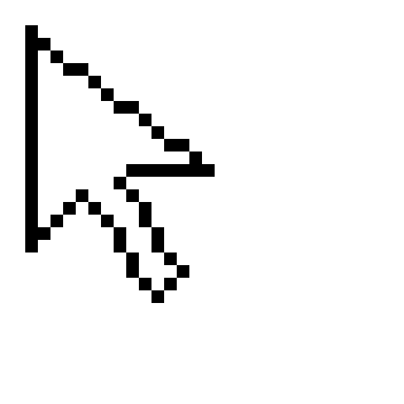

# WOTR-1.1-K7 · `SCCPointer.cur` for the retail Godot smoke (Executor)

**Card:** `4216f0cf-5705-815f-8124-ca2aa4f40097` · **Run:** `769051ce-01df-4757-833f-c4657acd8e87`
**Mission:** `41e6f0cf-5705-819f-a3ba-c15034fef51e` · **Role:** Godot World Engineer
**Zone:** `godot/wotr_remaster/**`, `docs/evidence/WOTR-1-1/K7/**`
**Date:** 2026-11-25

## 1 · The path this closes

The retail Godot smoke stopped on a missing asset:

```text
ERROR: cursor Arrow: no file SCCPointer.cur
GAME FAIL: shell: boot_shell: cursor Arrow: no file SCCPointer.cur
SMOKE FAIL: Godot exited 1 with retail paths configured
```

That is the K3 record (`docs/evidence/WOTR-1-1/K3-review.md`, line 12) and the
reason the owner opened a separate card for it (line 58). The engine resolves
the pointer in exactly one place:

| Step | Where |
|---|---|
| the cursor table | `GodotMouse::loadCursorTable` reads `data/ini/mouse.ini` out of the mounted archives |
| the image | `FindFileNoCase(<install>/data/cursors, SCCPointer.cur)` — case insensitive, no `res://` fallback |
| the bytes | `DecodeCursorFile` (`engine/src/GameClient/CursorFile.cpp`) |
| the failure | `m_cursorErrors` → `boot_shell: cursor Arrow: no file SCCPointer.cur` → the shell does not boot |

`data/ini/mouse.ini` names the pointer and its hot spot, and both retail trees
agree (`BFME2 1.06` `ini.big` and `RotWK 2.01` `ini.big`, extracted and read
during this card):

```ini
MouseCursor Arrow
  Texture             = SCCPointer.cur
  Image               = SCCPointer.cur
  HotSpot            = X:2 Y:2
End
```

The image itself is a **loose file of the install root**, not an archive entry.
The pinned retail snapshot (`openbfme.retail-big-transfer`) carries the 213 BIG
archives and not the loose files, and no retail byte may enter the repository
(invariant 4). So the pointer could not simply be fetched: **it had to be
owned.**

## 2 · What is in the tree

```text
godot/wotr_remaster/retail/
├── wotr_pointer_registry.gd   the asset and the registration
├── wotr_pointer_stage.gd       the command that registers it in an install root
├── run_retail_smoke.sh         the runner: the install overlay and the smoke
└── README.md                   the short form of this report
```

**The asset** (`wotr_pointer_registry.gd`) is the Remaster's own 32×32 arrow,
written as ASCII art in the source and encoded into a Windows cursor file at
run time:

| Field | Value |
|---|---|
| size | 4,286 bytes |
| SHA-256 | `93a7caaf210c566e48c229aad08e13a2be1b03309de33120a8f38f76565d89d1` |
| container | CURSORDIR (`type=2`, one image) + CURSORDIRENTRY (32×32, hot spot 2, 2) |
| image | BITMAPINFOHEADER (40 bytes, 32 bpp, height doubled), XOR bitmap BGRA bottom-up, 1-bit AND mask |
| hot spot | `X:2 Y:2` — the hot spot `mouse.ini` gives |

It is not a retail copy and not derived from one: the bytes are generated from
the ASCII source in the file, so no binary blob and no retail byte enter git.

**The registration** (`Registry.register_into`) writes the asset to
`<install root>/data/cursors/SCCPointer.cur` — the path and the name the engine
resolves. It is idempotent and non-destructive: an install that already carries
the file keeps its own pointer (`find_cursor` looks the name up ignoring case,
exactly as `FindFileNoCase` does).

**The runner** (`run_retail_smoke.sh`) prepares the install paths and measures
the smoke. The pinned retail trees are read-only inputs: the runner mirrors
them into an install overlay whose files are **links** to the pinned archives
(the pinned snapshot stays the only copy of the retail bytes), registers the
pointer in the overlay and runs the Arena smoke **unmodified** against it.

## 3 · The oracle: `tools/arena/smoke_godot.sh --retail`

The check is the smoke the card names, run with retail paths, twice: once with
the pointer registered (the acceptance run) and once with it left out (the
baseline, the run that used to fail).

```text
$ bash godot/wotr_remaster/retail/run_retail_smoke.sh --out=$OUT
$ bash godot/wotr_remaster/retail/run_retail_smoke.sh --no-pointer --out=$OUT
```

Both runs call `tools/arena/smoke_godot.sh --retail` as it is; the runner only
prepares `BFME2_INSTALL` / `ROTWK_INSTALL` and times the run.

| Run | Pointer | rc | Duration | Substantive output | Verdict |
|---|---|---|---|---|---|
| acceptance | registered | **0** | **11.916 s** | `SMOKE PASS: extension and scripts loaded with retail paths` | **pass** |
| baseline | left out | 1 | 11.506 s | `ERROR: cursor Arrow: no file SCCPointer.cur` · `GAME FAIL: shell: boot_shell: cursor Arrow: no file SCCPointer.cur` · `SMOKE FAIL: Godot exited 1 with retail paths configured` | fail (the old failure, reproduced) |

The acceptance log (`smoke.log`) is the whole output of the smoke — the
native banner, the retail mount and the shell:

```text
Godot Engine v4.7.2.stable.custom_build.ed1daf0bf (2026-08-17 01:18:38 UTC) - https://godotengine.org

OpenBFME 7c51eb3444 (2026-11-25)
RELEASE session log: <<<user>>>/.local/share/godot/app_userdata/OpenBFME/logs/openbfme-20261125-082221.log
GAME DISPLAY graphics preset high (auto: not measured yet: the first match measures it), 3D 100%
...
RELEASE game folders: env
GAME object world: ok=true, 4657 templates, 7 playable factions, 2.2 s
GAME audio booted: 7988 events
GAME shell booted in 159 ms: 12632 strings, lobby seed 18050
GAME screen: MainMenu.apt
SMOKE PASS: extension and scripts loaded with retail paths
```

The baseline log (`smoke-baseline.log`) is the same run with the pointer left
out; the shell never comes up:

```text
ERROR: cursor Arrow: no file SCCPointer.cur
   at: push_error (core/variant/variant_utility.cpp:1023)
   GDScript backtrace (most recent call first):
       [0] _boot (res://scripts/game.gd:1517)
       [1] _ready (res://scripts/game.gd:1276)
GAME FAIL: shell: boot_shell: cursor Arrow: no file SCCPointer.cur
SMOKE FAIL: Godot exited 1 with retail paths configured
```

The machine-readable form of both runs is `smoke.json` / `smoke-baseline.json`
(the runner writes them; `cursor_error` is the check that the old failure is
gone).

**The engine's own decoder accepts the asset.** `DecodeCursorFile` from
`engine/src/GameClient/CursorFile.cpp` — the very function the shell uses —
was compiled against the checkout's engine sources and run on the file the
smoke resolved (`cursor-decode.txt`, the source in `decode_check.cpp`):

```text
DecodeCursorFile: ok
width=32 height=32 hotX=2 hotY=2 frames=1 sequence=1 jiffies=1
```

## 4 · The pointer, seen

`pointer.png` is the registered asset, written by the stage command at 16× so
that it can be looked at. It is a mouse arrow: a white body with a black
outline, its tip at the top left, pointing up and to the left, on a
transparent ground. The tip sits on the hot spot (2, 2) that `mouse.ini`
names, so the click lands where the arrow points. The outline is one pixel
wide and follows the body: the shaft comes down from the tip, a notch marks the
step of the tail, and the tail ends in a point at the lower right. The pixels
are opaque where the arrow is and fully transparent everywhere else, so the
32×32 window adds nothing around the shape.



## 5 · Retail provenance

```text
manifest            openbfme.retail-big-transfer
manifest SHA-256    45bec1a3f698acddf223a2a6edebf73b40126b38dfc56c7061175af18d68b1ab
volumes             57 / 57 (parts 0001–0057), 5.25 GiB committed
archives            213 verified BIG archives (BFME2 1.06 + RotWK 2.01)
staging             every ingested part deleted; the staging folder holds the manifest only
state               .retail/.retail-big-transfer-state.json → "complete": true
```

The trees are read-only inputs of the run: the smoke reads the archives through
the overlay's links, the pinned snapshot is unchanged, and no retail byte (and
no retail-derived byte) is committed.

## 6 · Cost gate

```text
Cost gate (card):
  build:  none | focused      →  executed: focused extension build (see the deviation)
  retail: reuse | ≤5 volumes  →  executed: the rest of the hydration (see the deviation)
```

Two deviations, both declared:

1. **Build.** The card declares `build: none | focused`, and K7 touches no
   compiled source (no C++, no CMake, no generated file — only GDScript, a shell
   runner and markdown). The sandbox nevertheless had no extension binary
   (`godot/bin/openbfme.linux.template_debug.x86_64.so` was absent), and the
   oracle refuses to run without it. `tools/arena/build_engine.sh` (runtime
   mode, `GODOT=ON`, `TESTS=OFF`) was therefore run once: **30 min 31 s**, 1,925
   of 1,926 ninja steps, 0 errors. The binary is a build output and is not
   committed. No generated C++ was touched by K7, so no named Ninja target was
   needed.
2. **Retail.** The `.retail` tree of the sandbox was at **43 / 57** volumes —
   not a valid tree, so the card's "reuse" was impossible, and the smoke needs
   all 213 archives (the mount verifies every archive's md5). The remaining
   **14** volumes were hydrated instead of at most 5 (43 → 57, ~1.34 GiB,
   ~10 min of transfer). The overrun was the price of running the oracle at
   all: without a valid tree the smoke would have been `not run`.

## 7 · What was not done

* The oracle was run at the commit of this branch, not at a later one: the
  banner in `smoke.log` (`OpenBFME 7c51eb3444`) is the engine the extension
  was built from. K7 changes no compiled source, so the extension is the same
  binary on every commit of this branch; the GDScript and the runner are read
  from the working tree by the smoke, so the run covers the tree as it is
  committed.
* The full `openbfme_tests` suite was not run: the card's gate is `build:
  none | focused` and K7 changes no engine source. The engine's own cursor
  decoder was compiled and run on the asset instead (`cursor-decode.txt`).
* The engine sources were not touched: `GodotMouse.cpp`, `CursorFile.cpp`,
  `GodotRetailFileSystem.cpp` and `engine/tests/test_hud_cursors.cpp` were
  read only. The fix is the asset and its registration, inside
  `godot/wotr_remaster/**`.

## 8 · The files

| Path | What |
|---|---|
| `godot/wotr_remaster/retail/wotr_pointer_registry.gd` | the asset (ASCII source → Windows cursor file), its SHA-256, its preview and the registration |
| `godot/wotr_remaster/retail/wotr_pointer_stage.gd` | the headless command that registers the pointer in one or more install roots |
| `godot/wotr_remaster/retail/run_retail_smoke.sh` | the runner: the install overlay, the registration, the smoke and its measurement |
| `godot/wotr_remaster/retail/README.md` | the short form of this report |
| `docs/evidence/WOTR-1-1/K7/report.md` | this report |
| `docs/evidence/WOTR-1-1/K7/smoke.log` | the acceptance run (rc 0) |
| `docs/evidence/WOTR-1-1/K7/smoke-baseline.log` | the baseline run (rc 1, the old failure) |
| `docs/evidence/WOTR-1-1/K7/stage.log` | the registration's own report |
| `docs/evidence/WOTR-1-1/K7/smoke.json`, `smoke-baseline.json` | the machine-readable form of both runs |
| `docs/evidence/WOTR-1-1/K7/cursor-decode.txt`, `decode_check.cpp` | the engine's decoder on the registered asset |
| `docs/evidence/WOTR-1-1/K7/pointer.png` | the registered pointer, seen |
